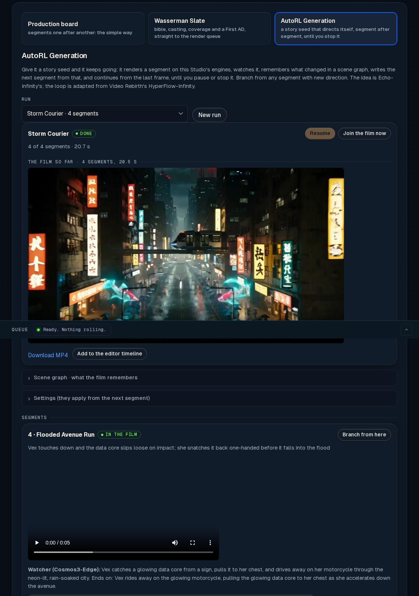
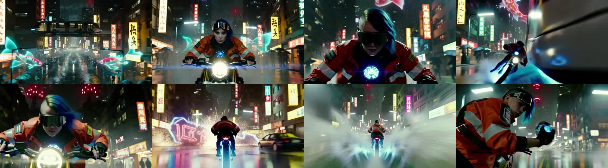

# AutoPilot

AutoPilot is the third way to plan a film in **Production**, beside the Production board and Wasserman Slate.
Give it a story seed and it keeps going: it renders a short segment on the Studio's own engines, watches it, writes
down what changed, decides what happens next, and renders that, continuing from the last frame, until it reaches the
number of segments you set or you stop it.

The idea of an endless video that watches itself is Echo-Infinity's (Yuxuan Bian, Nan Duan, Qiang Xu et al., CUHK
and Joy Future Academy, JD). The loop's design and parts of its memory and Director prompts are adapted from Video
Rebirth's HyperFlow-Infinity (Apache-2.0; `LICENSES/HyperFlow-Infinity-LICENSE`). AutoPilot does not use the HyperFlow
8-step adapter: segments render with the Studio's presets (FastH3 fh4, fh8, fh20, the Sharp Spec, Ref2VA, the LoRA hub)
and their quality.

Code: `app/autopilot.py` (the loop and its routes), `app/cosmos.py` (the vision brain), `app/static/autopilot.js` (the
panel), `tests/test_autopilot.py`.





## The loop

```
seed ──► Director ──► render (the queue) ──► QA gate + watcher ──► commit ──► (every N) join the film
            ▲                                       │ fail: next seed                │
            └──────── scene graph + last frame ◄────┴────────────────────────────────┘
```

1. **Seed.** A world, where the film starts, an optional inspiration, characters (a name, a look repeated in every
   segment, and a reference picture each where there is one), an optional opening picture. *Seed from a Slate film*
   fills it from a Slate film's bible: the world and its places, the logline, the characters' looks and pinned
   stills, the lookbook's style.
2. **Director.** The run's text brain (the film's brain: the Studio's own Bolt, Claude Code, Codex or a local server)
   reads the seed, the cast's pinned looks, the beats asked for so far, the scene budget, what the watcher saw the last
   segment show and how it ends, and the scene graph's bounded view, and answers with the Studio's own prompt fields:
   `scene`, `scene_change`, `beat`, `new_characters` and `shot` {setting, camera, action, dialogue, soundscape, music}.
   The Studio's builders (`compose`, `compose_references` in `server.py`) turn them into MiniMax H3's prompt, so the
   Studio's prompt rules hold (the quiet lines, the sound under its own heading). An answer is turned back, with the
   reason, and asked again (three tries) when:
   - its action is nearly word for word the segment before's (difflib ratio 0.9);
   - its beat restages one of the last 12 beats (ratio 0.85);
   - the scene has used its budget (`max_scene_segments`, 8) and it does not change scene;
   - three segments in a row in one scene showed the same events and states (stagnation) and it does not change scene
     with a new name;
   - it names what must not be seen (`negation.py`): the video model has no negative prompt.
3. **Render.** One `video` job through the Studio's queue, with the run's preset, quality, length and LoRAs, so it
   takes the same engines, memory guard and Spark routing as any clip. A continuation opens on the last frame of the
   segment before (`first_frame_from`, image to video). A new scene opens on the cast's reference pictures (Ref2VA,
   `references`) where that model is installed and someone has a picture, else from text with the pinned looks in the
   words; segment 1 may open on the opening picture. A reference is never combined with a first frame.
4. **Check and watch.** The QA gate (`qa.check`: the Whisper line check and the three-frame identity sheet) runs on
   each take, with the vision brain as its eyes. The watcher then gets eight frames of the segment in time order
   (seven evenly spaced and the last), each with its time, the Whisper transcript, the pinned looks and the scene graph,
   and answers with the scene graph's delta plus `summary`, `ending` (what the last frame shows: the Director continues
   from it), `continuity` (identity, costume, object or place problems) and `identity_drift`. Drift is confirmed by a
   second, narrower look (the first, middle and last frames, one question: the same face, hair, age and build?) before
   it counts: on the first real run Cosmos3-Edge's scene-graph answer called the courier mounting her vehicle "identity
   drift". A failed gate or confirmed drift renders the segment again at the next seed (`retakes`, one by default); the
   last take stands otherwise, with its reasons beside it.
5. **Commit.** The delta is merged; above 22 events the oldest 10 fold into a chapter written by the text brain.
   `memory/S0001.json` keeps the memory after each segment (a branch starts from one).
6. **Join.** Every `preview_every` segments (3) and on pause or finish, `film.mp4` is made again: a continuation
   drops the one frame it repeats and its sound cross-fades over the same 1/24 s, so picture and sound stay in step (a
   one-frame `xfade` is not used: ffmpeg 6.1 dropped the rest of the film with it); a new scene dissolves in over 0.25 s. The soundtrack runs through the joins; a *Score* line in the settings is laid into
   every segment's music.

**Pause** stops after the segment at work. **Stop** takes a segment still waiting in the queue out of it; one that is
rendering finishes and is picked up on resume. **Resume** carries on from the last committed segment, and an app
restart picks running runs up by itself. **Branch from here** makes a new run that shares segments 1..N (their clips
stay where they are) and the memory after N, and tells the Director the new direction for everything after N, as
direction rather than something that already happened.

## Measured

One run on a DGX Spark through the Studio's queue: 4 segments of 5 s at 864x480, FastH3 8 passes, Director Claude Code
(sonnet's default model), watcher Cosmos3-Edge (the Studio's own instance), QA gate on. 14 min in all, 20.5 s of film:
a render took 1 min 16 s to 2 min 4 s (the first includes ComfyUI loading), the check and watch 41 s to 1 min 25 s (Whisper on the processor, Cosmos loaded
for each look in about 3 s), the Director 9 to 17 s. One retake (the false drift described above, before the second
look existed) and one Director answer that was not JSON, written again.

## The vision brain

The watcher is NVIDIA **Cosmos3-Edge** on TensorFold by default (`studio:cosmos`): `cosmos.py` starts the Studio's own
instance on a loopback port (8362, `COSMOS3_PORT`) when a segment is watched, with `--vision --vision-max-images 9`, under a kill-guard
(15 GB available), and unloads it after 120 idle seconds and before any other local job of the queue, as Voice and
Music are. It loads in about 3 s and holds about 3.5 GB. Frames go as PNG data URLs (448x256 each, 112 image rows;
nine stay under the port's 1200 rows a request). A server that refuses that many images gets one time-ordered sheet of
the same frames instead. Set it in the AutoPilot panel or with `POST /api/autopilot/vision`:

- `studio:cosmos`: the Studio's own Cosmos (needs `COSMOS3_BIN` and `COSMOS3_MODEL`, default `$PREFIX/cosmos3/`);
- `http://host:port`: any OpenAI-compatible vision server on this computer, network or tailnet. Do not point it at
  another program's Cosmos, such as a voice agent's eyes: give the Studio its own;
- empty: the QA gate's own vision path (`qa.look`: the film's brain, Claude Code, Codex or a local vision model) on
  one frame sheet.

The Director stays on the text brain by default; `director: "vision"` asks the vision server instead.

## Files

`<studio folder>/autopilot/<run id>/`:

| File | What |
|---|---|
| `run.json` | name, seed, settings, state, segments (fields, prompt, mode, seed, takes, QA, watcher notes), log |
| `memory.json` | the scene graph now, the archive of folded events, `observed_through` |
| `scene-graph.schema.json` | the scene graph's JSON schema (below) |
| `memory/S0001.json` | the memory after segment 1, with its delta and the cast |
| `segments/S0001/` | `take1.mp4`, `director.json`, `watch-take1.json`, `frames-take1/`, `qa-take1.png` |
| `film.mp4` | the film so far |
| `vision.json` (in `autopilot/`) | the vision brain's address, model and frame count |

The scene graph:

```json
{"nodes": [{"id": "vex", "type": "character|place|object", "label": "Vex", "state": "soaked, core in hand, grinning"}],
 "events": [{"t": "00:12", "subject": "vex", "action": "jumps the gap to the relay roof", "target": "relay", "place": "rooftops", "segment": 3}],
 "chapters": [{"id": "ch1", "t_start": "00:00", "t_end": "01:05", "title": "Across the flooded city",
               "summary": "Vex crossed the city ahead of the storm.", "carried_forward": ["the drone owes her a favour"]}]}
```

States are at most 12 words and replace the old one; at most two events a segment, and only ones that change the
story; a node id the watcher misspells is folded into the existing one (`guard_2` is `guard`).

## The API

```
GET  /api/autopilot/runs                          the runs
POST /api/autopilot/runs                          {name, seed: {world, situation, inspiration, characters: [{name, look, image}], opening_image},
                                                settings: {style, guidance, preset, quality, seconds, segments (0 = until stopped), seed,
                                                max_scene_segments, qa, retakes, preview_every, identity, music, loras, brain}, start}
GET  /api/autopilot/runs/{id}                     the run and its memory
PUT  /api/autopilot/runs/{id}                     {settings, name}: applies from the next segment
POST /api/autopilot/runs/{id}/start | pause | stop | assemble
POST /api/autopilot/runs/{id}/branch              {after, guidance, segments?, seed?, start?}
GET  /api/autopilot/seed/slate/{project}          a seed from a Slate film's bible
GET  /api/autopilot/vision, POST /api/autopilot/vision  {endpoint, model, frames}
```

## Phase 2 (design only): continuing from the latents

Phase 1 continues from the last frame through image to video. That carries the picture but not the motion: a
continuation starts from a still, so a move in flight slows at the join, and the sound restarts. HyperFlow-Infinity
instead hands the next segment the last 7 normalized video latents of the one before, placed at the target's first
seven latent positions, generates 141 frames and trims the first 22 (the redrawn overlap), with one fixed identity image as a Ref2VA reference beside them. What our engines
would need:

**Both engines.**
- Save the denoised video latents of every segment (`[1, C, T, H/16, W/16]`, normalized as the decoder's input;
  float16 is enough) beside the clip, and the matching audio latents for the sound.
- A run-time input of K guide latents with their target positions, the clock shifted so that the guides take positions
  0..K-1 and the new rows follow (HyperFlow's `align_positions`): the guides are conditioning rows, not noise, so they
  are held at t = 0 in every pass, like a first-frame image's rows.
- A crop of the redrawn overlap after decode (22 frames for K = 7), and the same on the audio track, so the join has no
  repeated frames and the sound runs through it.
- AutoPilot then keeps a segment's `latents.pt` path and sends `--guide-latents path --guide-count 7` instead of
  `first_frame_from`; the QA gate and the watcher are unchanged.

**CUDA H3 engine (TensorFold `h3-cuda-*`, ComfyUI blocks through `TensorFoldH3Blocks`).** The FastH3 int8 route and
the image-to-video route already add a first frame's latent rows as clean conditioning; the change is K rows instead of
one, and positions from the guide list instead of 0. A ComfyUI node `StudioGuideLatents` would load the tensor, check
its shape against the canvas, and patch the packed sequence's positions; the sampler holds those rows clean. The
memory guard's estimate grows by K x rows per frame (at 864x480 a latent frame packs to 27 x 15 = 405 rows, so 7 guides add 2835 rows: small next to the clip's own). Sparse
attention must treat the guide rows like image rows (always attended).

**Metal H3 engine (TensorFold Zig + Metal, `tf-h3-dit`, and the MLX path).** The native engine takes a first frame as
VAE-encoded rows prepended to the sequence; it would take a file of K rows and a position offset instead, both on the
command line, and skip the VAE encode for them. The MLX engine (`minimax-h3-mlx`) has the same hook in its
`packing.reference_layout`. The decode crop is a slice before the VAE decoder, which also saves its time.

**Ref2VA.** HyperFlow sends the identity image through Ref2VA's reference path beside the guides; on our engines
Ref2VA renders only on MiniMax H3's own blocks (bf16, 20 or 4 passes), never FastH3. A latent continuation on FastH3
would therefore carry identity in words and in the guide rows, and a Ref2VA continuation would cost the Ref2VA time.

Risks: FastH3 was distilled on text to video; whether it holds K clean guide rows without the adapter HyperFlow trained
for exactly this is unknown and must be measured (same seed, a 5 s continuation, motion across the join, the identity
sheet, against Phase 1). The Turbo 4-step and HyperFlow 8-step adapters were trained with guides; the plain 20-pass
model may need more passes to blend them.
