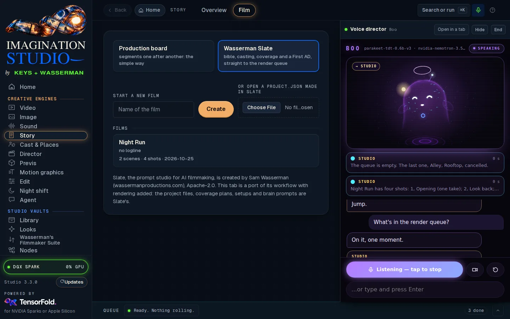
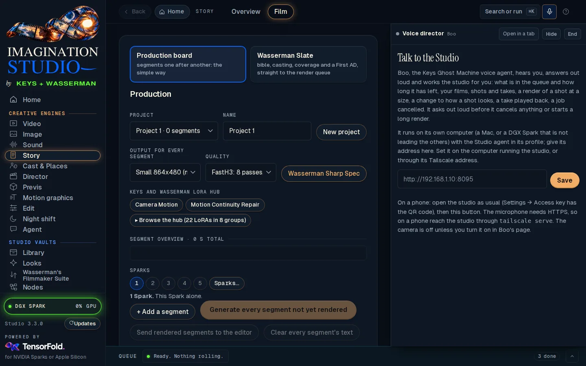
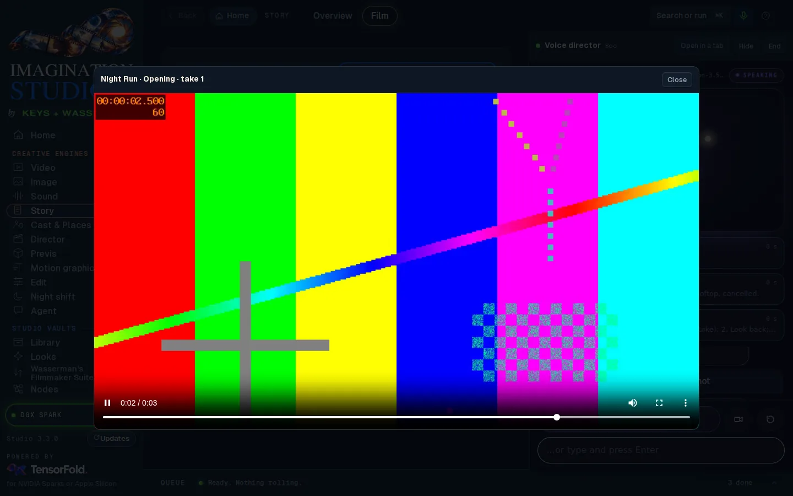
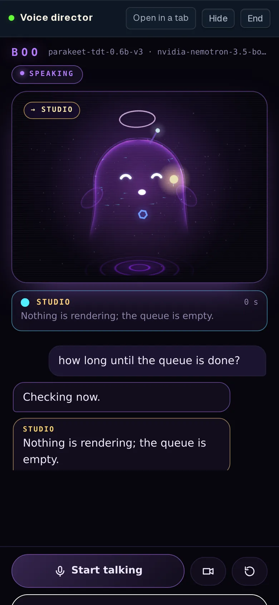

# The Voice panel: a hands-free voice director (Keys Ghost Machine)

The microphone button in the studio's header opens **Boo**, the
[Keys Ghost Machine](https://github.com/drowzeys/keys-ghost-machine-audio-visual-agent) voice agent, beside the studio
(full screen on a phone). Talk to it and it works the studio for you, out loud, through the studio's own API:

| Say | What happens |
|---|---|
| "What's in the render queue?" | What is rendering, its stage and time left, and what is waiting |
| "How long until the queue is done?" | The jobs' measured times added up, and how many have none |
| "Cancel the last job" · "stop the current render" · "cancel everything" | Boo asks out loud first, then cancels |
| "List my films" · "list my Slate shots" · "how many takes does shot 2 have?" | Read from the film saved last, or the one you name ("in the film Night Run") |
| "Start a render of the opening shot at 480p" · "render shot 3" · "re-render it at 720p" | Compiled and queued as Slate's own Render does, the take logged in the shot; a render expected to take longer than two minutes (or with no measured time) is asked first |
| "Make shot 3 darker and re-render it" | The brain rewrites the shot's prompt for the change (the old prompt stays in the shot's History), then renders it |
| "Play take 2" · "play shot 3" · "play the latest render" | The studio plays it over the page (take 1 is the first one made; a shot alone plays its circled take) |

Shots are named by number in the film's order ("shot 3", "the third shot"), as the opening or last shot, by name
("the shot called Rooftop"), or as "it" for the shot just talked about. Boo does not delete anything by voice: the
studio's own page has the trash and its undo.



## What runs where

Boo is not part of the studio. It runs on **its own computer**, a Mac or a DGX Spark that is not leading the others,
with its own speech recognizer (Parakeet), brain (Nemotron 3.5 Bolt) and voice (Fish Audio Drama 3). Its profile's
`brain` and `voice` are addresses, so it can use any Bolt and Drama 3 server you run for it. The studio only

- keeps the agent's address (`ghost.json` in the studio folder),
- serves the agent's page and its conversation socket on the studio's own address, under `/ghost/`, behind the
  studio's access key (`app/ghost.py`), so a phone that reaches the studio reaches Boo with nothing more to set up,
- plays a take when Boo asks it to.

Boo acts on the studio through the studio's HTTP API with the studio's access key, exactly as another app would: it
can do what the key allows and nothing else.

## Set it up

1. **On the computer that will run Boo**, install Keys Ghost Machine (its README, *One-shot install*) and make a
   profile from `profiles/studio.example.json`: set `agents.studio.url` to the studio's address as that computer
   reaches it (`http://192.168.1.10:7870`, a `.ts.net` name, or `http://127.0.0.1:7870` on the same computer).
2. **The access key.** A studio on another computer asks Boo for its key. On the studio's computer open
   **Settings → Access key** (or run `bash scripts/studio-key.sh`), copy the key, and on Boo's computer put it in a
   file only you can read:

   ```bash
   mkdir -p ~/.config/ghost-machine && umask 077 && pbpaste > ~/.config/ghost-machine/studio-key   # or paste it with an editor
   ```

   The profile names that file (`key_file`), or an environment variable (`key_env`). Boo reads it when it needs it and
   never writes it anywhere else; after *Make a new key* in the studio, copy the new one into the same file. A studio
   on the same computer as Boo needs no key.
3. **Start Boo** where the studio can reach it: `VOICE_HOST=0.0.0.0 ./serve.sh profiles/studio.json`
   (port 8095 by default). Keep that port to your own network or tailnet.
4. **In the studio**, click the microphone in the header, give Boo's address (`http://192.168.1.10:8095`) and
   *Save*. The address is set on the studio's computer or through its Tailscale address, like the brains; it must be
   on this computer, the network or the tailnet. The panel opens Boo's page once it answers.



In the panel, **Start talking** turns the microphone on. Speak over Boo to interrupt it. **Hide** keeps the
conversation going while you work; the header's microphone glows green while Boo is listening. **End** closes it.
**Open in a tab** gives Boo a tab of its own. The camera stays off unless you turn it on in Boo's page.



## Asking first

Boo asks out loud, and shows *Allow* and *Deny* on its page, before it:

- cancels a job (one, the one rendering, or all of them), and
- starts a render expected to take longer than `confirm_over_s` (120 seconds by default), or one with no measured
  time.

Say "yes" or "go ahead", or "no"; ninety seconds without an answer is a no. Nothing is cancelled or rendered when
there is no one to ask.

## On a phone

1. Reach the studio on the phone as usual (README, *Using it on your phone*: Tailscale, `tailscale serve --bg 7870`,
   then the QR code in **Settings → Access key**).
2. Tap the microphone in the header. Boo opens full screen; **Start talking**, and allow the microphone.

A browser lets a page use the microphone only over HTTPS (or on the computer itself), so on a phone open the studio
through `tailscale serve`, not through `http://` and an address. Boo's page comes through the studio's own HTTPS
address, so the phone needs no second address, certificate or key. Add `?voice=1` to the studio's address on the
home-screen icon to open straight into the Voice panel.



## Notes

- The studio carries the conversation's socket with the `websockets` package (in `requirements.lock`; the DGX Spark
  setup installs it with the studio's own packages). An install made before this version gets it with
  `bash oneshot-setup.sh --upgrade`; until then the panel says so and offers Boo at its own address.
- Boo's page loads Three.js and MediaPipe's face and hand trackers from their CDNs at pinned versions. The studio lets
  those two CDNs into `/ghost/` only, and frames that page from its own page only; the studio's other pages keep their
  own rules.
- Boo's brain rewrites a shot's prompt for a change ("darker") the way Slate's *Regenerate from feedback* does, and
  the old prompt is kept in the shot's History. A film open in another browser reloads it rather than overwrite it.
- Boo's voice is Fish Audio Drama 3 (Fish Audio Community License: a hosted voice service needs Fish's own licence).
